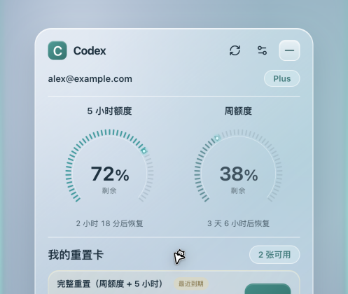
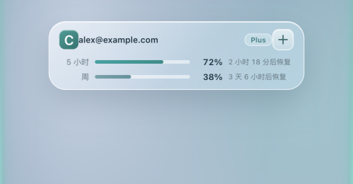
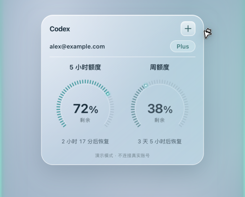

# Codex Quota Widget

一个 macOS 桌面悬浮卡片，实时显示 OpenAI Codex 账号的额度使用情况——5 小时额度、周额度、恢复倒计时、逐张重置卡的到期时间，一目了然。

> 动机很简单：Codex 经常在额度耗尽时"暴毙"，写代码写到一半才发现没额度了。与其被动挨打，不如把额度常驻在桌面上盯着。

| 展开态 | 迷你条 | 精简态 |
| --- | --- | --- |
|  |  |  |

## 功能特性

- **两种形态**：展开卡片 / 迷你条（360×104），随时切换，均保留账号信息；展开尺寸重启后保留
- **贴顶 Dock 式隐藏**：把迷你条拖到屏幕顶部即可停靠，鼠标悬停自动浮现、移开约 0.6s 后淡出，停靠时顶部有一条青色微光指示条，不会完全"失踪"
- **额度告警**：剩余额度 ≤10% 时对应额度环自动变红，提前预警
- **最近到期高亮**：临近到期的重置卡默认淡金色标记，悬浮卡片时切换为青色
- **卡名汉化**：服务端返回的英文重置卡名自动映射为中文
- **菜单栏图标开关**：可在设置里关闭 macOS 顶部菜单栏图标，只留悬浮卡
- **多屏定位**：按窗口所在显示器恢复位置，支持负坐标和不同缩放比例；物理多屏验收范围见验证记录
- **凭据零接触**：不读取、不存储任何 token。查询额度走 Codex App Server 子进程（stdio RPC），凭据始终留在 Codex 自己手里

## 技术栈

- **Tauri 2** + Rust（后端、托盘、单实例）
- **React 19 + TypeScript**（前端卡片 UI）
- **Objective-C 原生桥接**（`src-tauri/native/`）：Workspace 生命周期与顶部隐藏分开管理；淡出不移动窗口，避免动画触发位置保存
- **SQLite**（偏好设置与账号缓存，位于 `~/Library/Application Support/local.codex.quota-widget/`）

## 快速开始

需要 Node.js、Rust 和 Xcode Command Line Tools。

```bash
npm ci
npm run desktop:dev         # 原生开发模式，查询真实账号
npm run dev                 # 浏览器演示，永远使用假数据
npm run desktop:build       # 构建 release .app
npm test                    # TypeScript 测试
npm run test:rust           # Rust 测试
npm run test:native         # macOS 临时窗口回归，不访问账号
```

演示模式（不读真实账号）：

```bash
src-tauri/target/debug/codex-quota-widget --demo
```

只读诊断（只打印套餐与额度比例，不打印邮箱、卡片 ID 或认证信息）：

```bash
src-tauri/target/debug/codex-quota-widget --read-only-check
```

## 安全说明

- 源码不含任何硬编码密钥 / token / 真实账号信息
- 应用不读取或改写 Codex 认证文件，凭据通过 Codex App Server 子进程隔离
- SQLite 本地缓存仅保存 email、planType 等展示字段，不含认证凭据
- 目前为未签名构建（arm64），首次打开需在系统设置中放行 Gatekeeper

## 文档

[需求 PRD](docs/PRD.md) · [架构](docs/ARCHITECTURE.md) · [数据设计](docs/DB_DESIGN.md) · [计划](docs/PLAN.md) · [验证记录](docs/VERIFICATION.md) · [项目规则](AGENTS.md)

## License

MIT
