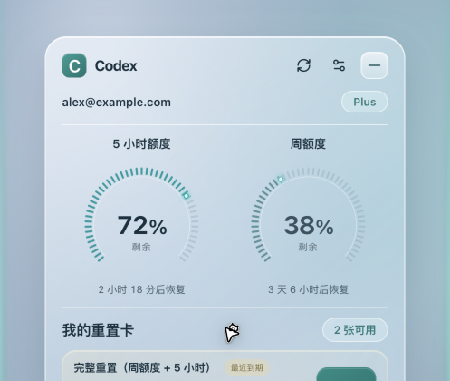
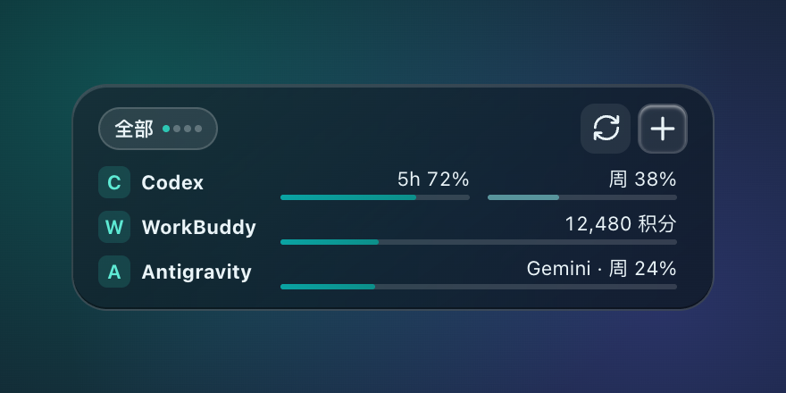
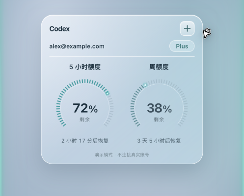

# Codex Quota Widget

一个 macOS 桌面悬浮卡片，实时显示 OpenAI Codex 账号的额度使用情况——5 小时额度、周额度、恢复倒计时、逐张重置卡的到期时间，一目了然。

> 动机很简单：Codex 经常在额度耗尽时"暴毙"，写代码写到一半才发现没额度了。与其被动挨打，不如把额度常驻在桌面上盯着。

| 展开态 | 迷你条 | 精简态 |
| --- | --- | --- |
|  |  |  |

## 功能特性

- **两种形态**：展开卡片 / 迷你条（360×104），随时切换，均保留账号信息；展开尺寸重启后保留
- **贴顶 Dock 式隐藏**：把迷你条拖到屏幕顶部即可停靠，鼠标悬停自动浮现、移开约 0.6s 后淡出，停靠时顶部有一条青色微光指示条，不会完全"失踪"
- **额度告警**：剩余额度 ≤10% 时对应额度环自动变红，提前预警
- **最近到期高亮**：临近到期的重置卡默认淡金色标记，悬浮卡片时切换为青色
- **卡名汉化**：服务端返回的英文重置卡名自动映射为中文
- **菜单栏图标开关**：可在设置里关闭 macOS 顶部菜单栏图标，只留悬浮卡
- **多形态低占屏布局**：支持「贴边圆环条」「迷你横条」与「仅菜单栏」三种模式；菜单栏保持纯图标简洁呈现。
  - **仪表盘式圆环条**：`56px` 宽磨砂胶囊，采用 `280°` 底部开口马蹄形进度弧，中央完整展示 Codex / WorkBuddy / Antigravity 三来源专属图标，底部开口处直显 5 小时剩余比例；支持桌面任意拖动、近边自动吸附与可选空闲折叠光条。
  - **独立无闪烁侧边详情窗**：悬停详情卡运行在独立的透明无边框悬浮窗（`rail-popover`）中，鼠标移入、切换来源或移出收起时主圆环窗不移动不缩放，消除单窗口缩窄闪烁；支持无焦点悬停、屏幕底边自动避让与悬停直显今日 Token。
- **暗黑玻璃与防截屏**：支持跟随系统 / 浅色 / 暗黑磨砂玻璃主题，可选开启截图隐身（`NSWindowSharingNone`）。
- **独立控制中心与本地 Token 用量统计**：按需打开的宽屏控制中心，纯本地只读增量解析 Codex、WorkBuddy 与 Antigravity 会话日志，展示今日 / 7 天 / 30 天 / 全部的 Token 总量、缓存命中率、估算等值 API 费用（CNY/USD）与每日堆叠柱状图，不上传任何数据。
- **多屏定位**：按窗口所在显示器恢复位置，支持负坐标和不同缩放比例；物理多屏验收范围见验证记录
- **订阅有效期**：偏好设置 → 显示订阅有效期（默认关闭）。开启后，展开卡片和迷你条都在邮箱下显示订阅有效期与剩余天数；迷你条使用短日期，鼠标停在日期上可查看具体时间。

## WorkBuddy 与多来源视图

迷你条通过左侧选择器切换「全部来源 / Codex / WorkBuddy」。全部来源保留 Codex 的 5 小时、周额度及 WorkBuddy 积分，点击来源行可展开该来源详情。展开卡片顶部切换来源，设置中可分别启用，至少保留一个来源。首次升级默认同时启用两个来源。

WorkBuddy 使用本机当前登录账号，只读读取当前用户的 `Library/Application Support/CodeBuddyExtension/Data/Public/auth/workbuddy-desktop.info`。加密字段通过已安装 WorkBuddy 的 Node 运行时在内存中解码，支持按应用标识发现安装位置及用户 Applications 目录；未安装、未登录、加密格式不支持时提示重新登录或更新客户端。不会写入 WorkBuddy 登录文件。积分请求固定发往 `https://copilot.tencent.com/billing/meter/` 下的 `get-user-resource-summary`、`get-user-resource-paid-packages`、`get-user-resource-free-packages` 三个只读接口，使用 macOS 网络代理与证书设置。

界面展示接口实际返回的套餐、积分剩余量、积分总量和有效积分包。积分包分页读取，最近到期优先，未知日期排最后。到期日来自扣除结束时间或包过期时间，保留年/月/日和时分；套餐周期结束时间不当作包过期日。明细失败时显示提示，汇总仍可使用。今日消耗、本月消耗暂未接入。各来源分别刷新，失败时标明异常，网络失败可保留本次会话的上次数据。WorkBuddy 登录失效时清除该来源显示，凭据不进入前端、SQLite 或日志。登录启动仍需用户在设置中主动开启。

## Antigravity 额度

Antigravity 默认关闭，可在偏好设置中启用。为避免触发第三方 OAuth 条款风控，小组件不读取或保存任何 Google OAuth 凭据，采用本机双路线只读查询：

- **主路线（桌面端）**：优先查询本机运行中的 `Antigravity.app` / `Antigravity IDE.app` 本地 `language_server`（仅限 `127.0.0.1` 回环 HTTPS），返回各模型组额度与套餐名称。
- **兜底路线（`agy` CLI）**：桌面端未运行时，尝试调用本机 `agy` CLI（强制校验版本 `>= 1.1.11` 后执行只读 `/usage`，不触发模型对话、不消耗额度）。

恢复时间以服务端返回为准。迷你视图隐藏 Claude / GPT 组，迷你总览显示其余额度里剩余比例最低的窗口。三个来源同时开启时，总览为 360×128，其余迷你视图为 360×104。

## 技术栈

- **Tauri 2** + Rust（后端、托盘、单实例，以及独立的控制中心与侧边详情悬浮窗）
- **React 19 + TypeScript**（前端卡片 UI、仪表盘圆环与共享详情卡视图）
- **Objective-C 原生桥接**（`src-tauri/native/`）：Workspace 生命周期、顶部隐藏与双窗口无焦点指针监控；独立详情窗以 `orderFrontRegardless` 前置展示且不抢占当前应用焦点
- **SQLite**（偏好设置与账号缓存，位于 `~/Library/Application Support/local.codex.quota-widget/`）

## 快速开始

需要 Node.js、Rust 和 Xcode Command Line Tools。

```bash
npm ci
npm run desktop:dev         # 原生开发模式，查询真实账号
npm run dev                 # 浏览器演示，永远使用假数据
npm run desktop:build       # 构建 release .app
npm test                    # TypeScript 测试
npm run test:rust           # Rust 测试
npm run test:native         # macOS 临时窗口回归，不访问账号
```

演示模式（不读真实账号）：

```bash
src-tauri/target/debug/codex-quota-widget --demo
```

只读诊断（只打印套餐与额度比例，不打印邮箱、卡片 ID 或认证信息）：

```bash
src-tauri/target/debug/codex-quota-widget --read-only-check
```

## 安全说明

- 源码不含任何硬编码密钥 / token / 真实账号信息
- 额度查询通过 Codex App Server。开启订阅日期选项后，Rust 按本机 Codex 的配置读取当前登录信息，只把核对过账号归属的日期传给界面。
- SQLite 本地缓存仅保存 email、planType 等展示字段，不含认证凭据
- 目前为未签名构建（arm64），首次打开需在系统设置中放行 Gatekeeper

## 文档

[需求 PRD](docs/PRD.md) · [架构](docs/ARCHITECTURE.md) · [数据设计](docs/DB_DESIGN.md) · [计划](docs/PLAN.md) · [验证记录](docs/VERIFICATION.md) · [项目规则](AGENTS.md)

## License

MIT

订阅日期优先使用当前进程的 `CODEX_HOME`，默认使用当前用户的 `~/.codex`。自定义目录需对启动卡片的进程可见。支持文件存储、macOS 的 Codex 直接钥匙串条目，以及 auto 模式下条目不存在时的文件回退。仅内存登录、无法读取的加密存储、权限不足或令牌未提供有效期时隐藏日期。日期表示当前权益有效至该时间，续费及取消状态请以订阅管理页面为准。

开启订阅有效期后，若匹配账号的本地日期已过，助手使用当前访问令牌向 chatgpt.com 查询同一工作区的权益。未取得日期时，请 Codex 通过 `account/read` 更新登录凭据后重试。查询结果仅缓存在内存中，当前账号 15 分钟内复用结果；仍未取得新日期时显示待同步。
