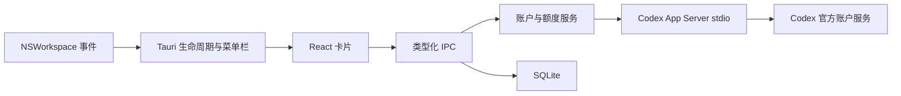

# 技术架构

更新：2026-11-05。用户已选择 Tauri 技术栈；本文件替代此前 SwiftUI 设计。

## 技术栈与环境

- Tauri 2.12.5：透明 WebView、原生磨砂、菜单栏、窗口管理。
- React 19 + TypeScript 5.8 + Vite 7：界面与状态。
- Rust 1.99.1：Codex RPC、身份核对、SQLite、消费处理。
- SQLite / rusqlite：本地设置与最近快照。
- 极小 Objective-C 桥接：订阅 NSWorkspace 的 Codex 启停、休眠及降低透明度事件；不是 SwiftUI 应用。
- tauri-plugin-autostart：用户主动操作后注册登录启动；不在启动时自动开启。
- Node 24.14.0、Xcode 27.1、macOS 26.6.2（arm64）为本次构建环境。最低部署目标 macOS 13，尚未在旧系统实测。

精确依赖见 package-lock.json、src-tauri/Cargo.lock。Rust 工具链安装在项目 `.toolchain`，不修改全局 PATH。

## 系统结构

## 模块

| 文件 | 职责 |
|---|---|
| src/App.tsx | 页面组合、导航和状态反馈 |
| src/components/ | 卡片头部、额度展示、设置页、卡片列表、消费确认 |
| src/hooks/useRedemption.ts | 唯一显式消费处理器，捕获账号/卡片/幂等键 |
| src/hooks/useWindowBehavior.ts | 绑定移动/缩放事件，防抖保存 |
| src/window/controller.ts | 模式切换先停止隐藏，记录各视图尺寸 |
| src/window/geometry.ts | 多屏物理坐标与逻辑尺寸、工作区约束 |
| src/window/bridge.ts | Tauri 窗口 API，账户 IPC 与窗口 API 分离 |
| src/Gauge.tsx | SVG 分段光环与终点微光 |
| src/useWidget.ts | 刷新调度、生命周期、陈旧状态 |
| src/bridge.ts | Tauri IPC 与完全隔离的浏览器演示数据 |
| src/model.ts | 时间、比例和卡片显示规则 |
| src-tauri/src/lib.rs | 命令注册、菜单栏、原生事件转发、共享 SQLite 连接 |
| src-tauri/src/window.rs | 窗口显隐与顶部隐藏命令 |
| src-tauri/src/rpc.rs | 发现 Codex、stdio 握手、请求匹配和超时 |
| src-tauri/src/provider.rs | 查询、账号复核、指定卡片消费 |
| src-tauri/src/model.rs | 上游字段归一化 |
| src-tauri/src/storage.rs | 四张 SQLite 表与事务 |
| src-tauri/native/workspace.m | 按 bundle ID 监听应用，不扫描进程表 |
| src-tauri/native/top_hide.m | 顶部停靠、淡出/恢复、鼠标监测与提示条 |

## IPC 接口

| 命令 | 参数 | 结果/约束 |
|---|---|---|
| bootstrap | 无 | 设置、缓存、生命周期、是否演示模式；无网络请求 |
| save_preferences | preferences | 校验刷新间隔和展开尺寸；仅图标偏好改变时更新托盘 |
| arm_top_hide | 无 | 仅迷你态调用；按窗口所在屏幕工作区检查顶部距离 |
| disarm_top_hide | 无 | 停止鼠标和动画定时器，恢复透明度/鼠标响应 |
| refresh_snapshot | 无 | 读取真实账号和额度，写成功快照；不消费 |
| consume_credit | accountKey / creditId / attemptId | 仅确认按钮调用；精确所选 ID；无自动重试 |

事件：`codex-state` 携带 running/sleeping/reduceTransparency；`menu-action` 携带 show/settings/refresh。

## 官方接口与身份

每次操作启动一个短生命周期 Codex App Server，使用安装的 Codex 自有配置，不手工读取 token，不启动模型回合。读取完成后终止自己的辅助进程，不保留空闲服务器。

流程：initialize → initialized → account/read → account/rateLimits/read → account/read。前后账户信息变化时放弃结果。额度窗口按时长匹配 300 和 10080 分钟；缺失显示未知。

本机协议已实测返回 accountId；缓存键为账户 ID 与邮箱组合的 SHA-256。账户 ID 提供工作区范围，邮箱只作为工作区内用户区分，并非唯一身份依据。无账户 ID 时拒绝建立可消费上下文。

实际桌面端由 `com.openai.codex` 标识（本机安装名为 ChatGPT.app）。本机只读链路可用；没有主动切换用户当前账号或工作区做破坏性验证，所以复杂多工作区切换仍是实测边界。

## 指定卡消费

用户选择 → 确认框固定账号与卡片 → 后端重新读取身份和卡片 → 核对 accountKey 与有效状态 → `account/rateLimitResetCredit/consume` 传 creditId 和 UUID 幂等键 → 显示结果 → 刷新。

结果区分 reset / alreadyRedeemed / nothingToReset / noCredit。传输超时或未知响应显示待确认，不自动重试、不更换卡片、不在重启后恢复消费。

用户明确要求开发过程不真实调用消费接口。本次使用协议替身验证，不拿真实重置卡做测试。

依据：[官方 App Server](https://learn.chatgpt.com/docs/app-server)。参考项目提交 `07ad243057b7cd0f8fc2fb4292e00b83f8910060` 仅用于理解功能，没有复制其实现代码。

## 窗口与刷新

- 半透明原生磨砂 + CSS 玻璃层，桌面背景自然透出；不内置原型壁纸。
- 默认 5 分钟刷新；支持 1–60 分钟及手动模式；合并同时发生的刷新。
- 倒计时在可见时每 30 秒检查，展示到分钟；不产生周期消费请求。
- Codex 退出时隐藏并暂停自动刷新；休眠暂停，唤醒按运行状态更新。
- 主线程显示；阻塞 RPC、网络和快照写入放在后台任务。
- 顶部隐藏只淡出，不移动窗口；动画不会制造坐标事件或错误的位置存档。退出迷你态、隐藏卡片或显式显示时，取消隐藏和动画并恢复输入。
- 恢复位置遍历所有显示器，支持负坐标和不同缩放比例；按对应屏幕工作区约束完整窗口。顶部热区使用 AppKit 窗口自身 screen，不使用 mainScreen。
- 展开尺寸 expandedSize 使用逻辑点持久化；精简态固定 360×104，设置和确认页尺寸只在本次运行记忆。切换模式时同步调整最小尺寸，刷新不触发窗口缩放。
- SQLite 在启动时初始化并复用 Mutex 保护的连接；RPC 在锁外执行。移动/缩放保存防抖 500ms，置顶和图标操作仅在对应偏好改变时执行。
- 停靠状态仍以 200ms 检查鼠标，增加 40ms 容差供系统合并唤醒；退出停靠立即停止。保留短生命周期 App Server，不为未测定的收益引入常驻连接。
- 网络失败保留缓存并标记，不视为实时数据。明确未登录或认证类型不支持时清空界面快照。

## 打包与验证

运行命令和本机包位置见 README。已完成构建、单元测试、真实只读查询与原生演示窗口检查。登录启动注册、真实休眠、多显示器、账号切换和长期资源指标尚未全量实测，不声称全部验收通过。

订阅日期由独立的只读命令 `subscription_active_until(accountKey)` 提供。Rust 校验已保存的开关，在后台按当前 Codex 目录及凭据存储配置读取登录信息，优先解码 ID 令牌，其次访问令牌。只有邮箱与工作区计算出的账号键与快照相同才返回订阅有效期。界面在切换账号、关闭开关及日期缺失时隐藏该行。

开启订阅有效期后，若匹配账号的本地日期已过，助手使用当前访问令牌向 chatgpt.com 查询同一工作区的权益。未取得日期时，请 Codex 通过 `account/read` 更新登录凭据后重试。查询结果仅缓存在内存中，当前账号 15 分钟内复用结果；仍未取得新日期时显示待同步。
