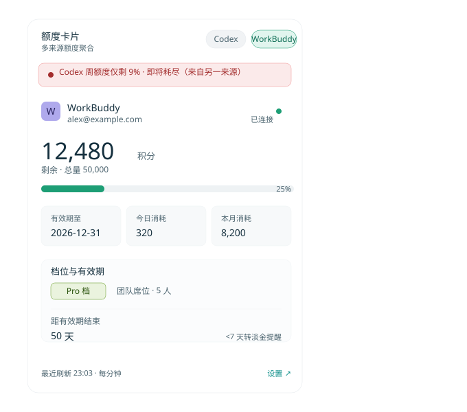
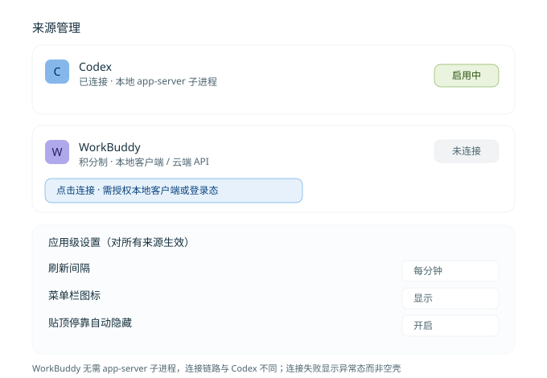

# 多来源额度卡片 · 设计文档（原型阶段）

> 状态：**原型设计，未实现**。本文档记录多来源（Codex + WorkBuddy）支持的架构决策、数据契约与原型，代码落地前需先在「待拍板事项」上确认口径。
> 创建日期：2026-11-11

## 1. 背景与目标

现有卡片（v0.1.0）是**单来源假设**：品牌头写死「Codex」、账号行、`followCodex` 偏好、双分段光环（5 小时 / 周）、重置卡列表，全部围绕 Codex 一个来源长出来。

新需求：在保留 Codex 能力的同时，接入 **WorkBuddy（积分制）**。两个来源数据形态不对称：

| 维度 | Codex | WorkBuddy |
|------|-------|-----------|
| 计量口径 | 时间窗口（5 小时 / 周）+ 多个重置卡 | 积分池（剩余 / 总量）+ 有效期 |
| 可操作对象 | 重置卡（订阅） | 档位（Free/Pro/Team） |
| 数据来源 | 本地 app-server 子进程 stdio RPC | 本地客户端 / 云端 API（待确认） |

## 2. 核心决策：把「来源」提升为一级对象

不采用「加一个 tab / 切换器」的局部修补——那会让第三个来源（如 Gemini）再拆一次。正确做法是：

- **应用身份**与**来源身份**解耦：顶部标题改为中性的「额度卡片」，Codex / WorkBuddy 降为来源层（chip）。
- **UI 全部数据驱动**：窗口数量、标签、是否有重置卡、是否用积分，都由 `Source` 契约给出，组件不写死「5 小时 / 周」或「重置卡」。
- **分层聚合**：迷你条聚合所有来源的最吃紧指标；展开态下钻单个来源详情；跨来源告警在卡片顶部统一呈现。

## 3. 信息架构（三形态不变）

现有三种形态（展开 / 精简 / 迷你条）的结构保留，仅把内部渲染改为来源遍历：

- **迷你条**（360×104）：每个来源 **一行**，取该来源最吃紧的一条指标（Codex 取剩余比例最低的窗口，WorkBuddy 取积分剩余比例）。告警来源整行左侧红条。高度不增长。
- **展开态**：来源 chip 切换；当前来源详情（主读数 + 窗口/积分 + 区块）；顶部跨来源聚合告警条。
- **精简态**：保留账号信息，聚合读数。

## 4. 归一化数据契约

组件渲染的唯一输入。新增 `metricType` 区分两种形态：

```text
Source {
  id: string
  name: string                 // 展示名，如 "WorkBuddy"
  glyph: string                // 图形标识，如 "W"（低饱和方块，不抢语义色）
  account: string              // 账号 email
  connection: 'connected' | 'stale' | 'unauthorized' | 'error'
  metricType: 'window' | 'points'   // 决定主读数呈现

  windows?: Window[]           // Codex 用
    { label, remainingPct, resetAt }
  points?: {                   // WorkBuddy 用
    remaining, total,
    expireAt,                  // 有效期
    tier,                      // Free / Pro / Team
    todayUsed, monthlyUsed
  }

  alertRule: {                 // 告警判定（来源自定义）
    lowPct?: number,           // 剩余比例阈值，默认 10
    expireWithinDays?: number  // 距过期天数阈值，默认 7
  }
}
```

- `windows` 为空 → **不渲染重置卡区块**，改为「档位 + 有效期」区块。
- 缺字段（如 WorkBuddy 未提供 `tier`）→ 显示「未提供」，不补 0%、不猜到期时间。

## 5. 状态矩阵

每个来源独立判定，坏一个不拖另一个。语义色固定：**红=告警 / 金=到期 / 青=悬浮**，来源本身只用低饱和图形区分（C 蓝灰、W 紫灰），**不得用颜色区分来源**。

| 状态 | 来源 chip | 卡片表现 |
|------|-----------|----------|
| 正常 | 最吃紧读数 | 无 |
| ≤阈值 告警 | 红点 + 读数 | 整卡红边 + 顶部聚合告警条 |
| 数据陈旧 (stale) | 灰点 + 上次更新时间 | 沿用现有 stale banner |
| 未连接 / 需授权 | 「点击连接」 | 该来源详情位显示引导，不显示空壳 |
| 缺字段 | 「未提供」 | 不补默认值 |

积分特有告警：剩余比例 ≤ `lowPct` **或** 距 `expireAt` ≤ `expireWithinDays`，任一命中即走红/金语义。

## 6. 原型

### 6.1 展开态（WorkBuddy 积分详情）


要点：主读数从百分比窗口换成「剩余积分大数字」；无重置卡，改为「档位与有效期」区块；顶部保留跨来源聚合告警（Codex 快见底也要吼出来）。

### 6.2 迷你条（双来源聚合）


要点：每来源一行取最吃紧指标；告警来源整行左侧红条；高度锁定 360×104。

### 6.3 设置页（来源管理）


要点：来源级（是否启用、账号、连接）与应用级（刷新间隔、菜单栏图标、贴顶停靠）分层；WorkBuddy 连接走本地客户端/云端 API，无需 app-server 子进程，连接失败显示异常态而非空壳。

## 7. 视觉规范与对比度 QA

- 玻璃底 `#e9f3f7` 上：正文 `#16313f` ≈ 12:1（过 AA）；辅助文字必须用 `#4d6570`（≈5.46:1），原 `#617780` 仅 4.18:1 不达标。
- 青色 `#0f8f8a` 仅作描边 / 读数底色，**不得作正文**（仅 3.5:1）。
- 来源 chip 需键盘可达，`aria-label` 带上状态文字。
- 贴顶停靠状态机（Objective-C 原生）原样不动，多来源不影响窗口动画逻辑。

## 8. 待拍板事项（实现前必须确认）

1. **WorkBuddy 积分字段**：总量是否固定？有无档位 / 团队席位？
2. **数据来源**：本地客户端接口 or 云端 API？是否需要额外登录态？决定「连接」这一步的形态。
3. **多工作区 / 多账号**：来源下是否还需再套一层账号切换？

## 9. 实现路径提示（仅方向，未落地）

- 不动现有 Codex 逻辑，新增 `Source` 抽象层；现有 `model.ts` 的 `localizedTitle` / demo 数据改为按 `metricType` 分支。
- `App.tsx` 把「单账号渲染」改为「来源遍历 + 当前来源下钻」。
- 设置页 `Preferences` 增加 `sources[]`（来源级）与既有应用级配置分层。
- 凭据安全原则不变：widget 不接触 token，WorkBuddy 数据走其约定通道。
